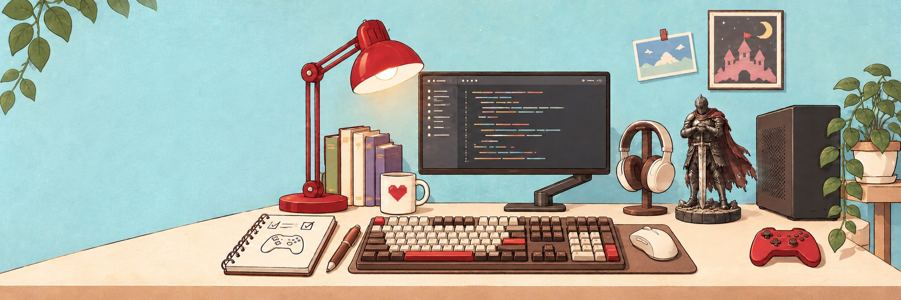

  

# Legnic · Game Dev Studio

**Unity · C# | 게임 클라이언트 프로그래머**

게임의 동작을 구현하고, 제작 중 마주한 문제를 분석하며 개선합니다.

## Projects

### ProtoRhythm

4레인 리듬게임 · 개인 프로젝트

- 일반 노트와 롱노트, 여러 난이도의 채보 지원
- Object Pooling · 비동기 로딩 · Addressables 적용
- 소스 코드: 비공개

### MEET YOU

2인 협동 퍼즐·방탈출 게임 · 팀 프로젝트

분리된 공간에서 서로의 정보를 주고받고, 상호작용으로 생긴 변화를 관찰하며 퍼즐을 해결합니다.

[Repository](https://github.com/Legnic/MultiMystery)

## Tools

`Unity` · `C#` · `Visual Studio` · `Git` · `GitHub`

