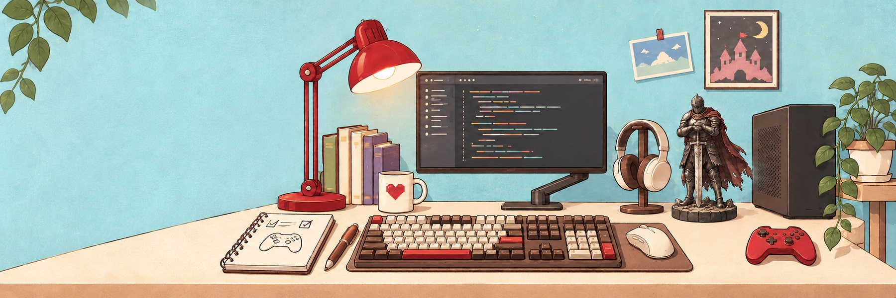

  

# Legnic · Game Dev Studio

**Unity · C# | 게임 클라이언트 프로그래머**

게임의 동작을 구현하고, 제작 중 마주한 문제를 분석하며 개선합니다.

## Projects

### Flip & Land

일상 속 물체를 던져 회전시킨 뒤 똑바로 세우는 원버튼 타이밍 아케이드입니다.

- 버튼을 누르고 떼는 타이밍으로 던지는 힘과 공중 회전 속도를 조절합니다.
- 공중 궤적은 포물선으로 계산하고, 착지 순간의 기울기와 회전 속도로 성공 여부를 판정합니다. 실패 후 물체가 넘어지는 동작에는 Unity 물리를 사용합니다.
- Unity 6에서 3개 테마, 30개 스테이지를 구현했습니다. PC 가로 화면과 Android 세로 화면·터치 입력을 지원하며, 두 플랫폼의 MVP 빌드를 완료했습니다.

### ProtoRhythm

4레인 리듬게임 · 개인 프로젝트

- 일반 노트와 롱노트, 여러 난이도의 채보 지원
- Object Pooling · 비동기 로딩 · Addressables 적용
- 소스 코드: 비공개

### MEET YOU

2인 협동 퍼즐·방탈출 게임 · 팀 프로젝트

분리된 공간에서 서로의 정보를 주고받고, 상호작용으로 생긴 변화를 관찰하며 퍼즐을 해결합니다.

[Repository](https://github.com/Legnic/MultiMystery)

## Tools

`Unity` · `C#` · `Visual Studio` · `Git` · `GitHub`

